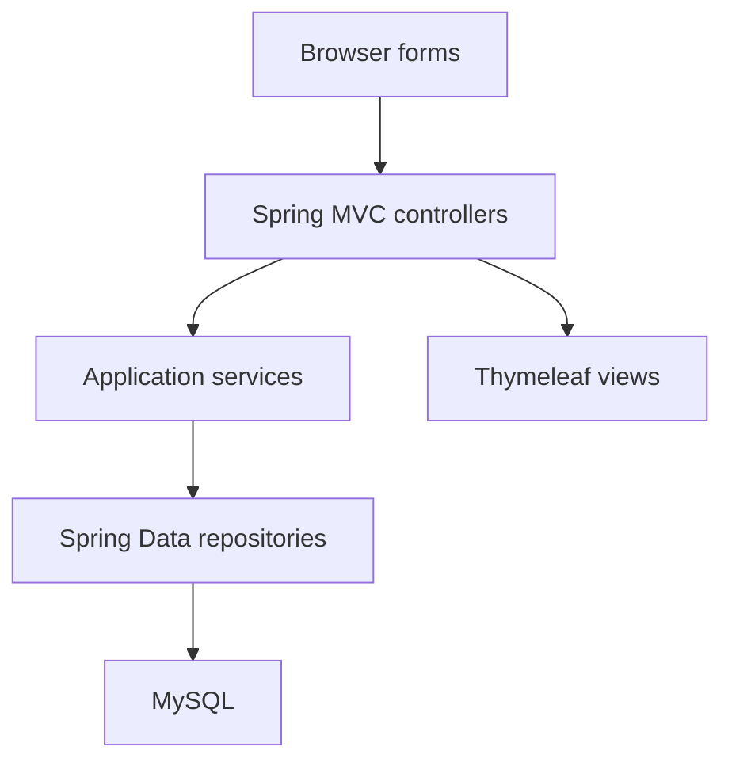

# Technical review — Java Library

Source baseline: `673bad6a2789e462ef258bca3fe261cde53064fd` (2026-11-16 review). This is a source review of a historical learning application, not a security certification.

## Implemented architecture

Controllers prepare views and delegate operations to services. Entities are persisted through JPA. Some controllers also access repositories directly, so the layering is a convention rather than an enforced boundary.

## Evidence and proposed work

| Observation | Evidence | Proposed change — not implemented here |
| --- | --- | --- |
| CSRF explicitly disabled | [Security.java](../src/main/java/com/egg/libreria2/Security.java) | Enable CSRF, adapt forms, test missing/valid tokens |
| Incomplete endpoint policy | Same configuration | Define public and protected routes and verify roles |
| GET deletes a book | [PortalController](../src/main/java/com/egg/libreria2/controller/PortalController.java), `libroDisponibilidad` | Authorized POST/DELETE with CSRF, plus HTTP tests |
| Quantity fields checked for null but no full stock invariant | [LibroService](../src/main/java/com/egg/libreria2/services/LibroService.java), `AgregarLibro`/`Save` | Reject negative values and inconsistent totals in the service |
| Missing records accessed with `Optional.get()` before the presence check | Same service, `eliminarLibro` | Resolve once with an explicit not-found outcome |
| Schema auto-update | [application.yml](../src/main/resources/application.yml) | Baseline and version migrations against a disposable DB |

Prioritize browser authorization/CSRF and destructive routes first, then domain validation and persistence reproducibility. Keep each behavior change in a separate reviewable PR with tests. These observations remain open after this documentation-only change.

## Testing strategy — proposed

Use service tests for stock invariants and missing records; MVC security tests for login, roles, CSRF and forbidden operations; MySQL Testcontainers tests for real persistence and rollback. The current context-loading test does not establish those properties.

No migration, Docker Compose, OpenAPI specification, CI pipeline or Testcontainers implementation is introduced by this PR.

## Presenting this project

“I built or contributed to this earlier Java/Spring learning application” should be adjusted to the contribution history that can actually be shown. Explain the MVC/service/repository flow, then discuss the security and validation limitations transparently. Use the repository as a learning-history example rather than proof of recent production architecture.

Interview discussion:

1. Why is a GET handler that deletes data unsafe even when a login form exists?
2. What does BCrypt solve, and which authorization and session concerns remain?
3. Where should the relation between total, borrowed and remaining copies be enforced?
4. Why is a context-loading test insufficient to verify role and ownership rules?
5. What risks does Hibernate schema auto-update introduce when moving from a local exercise to a shared environment?
