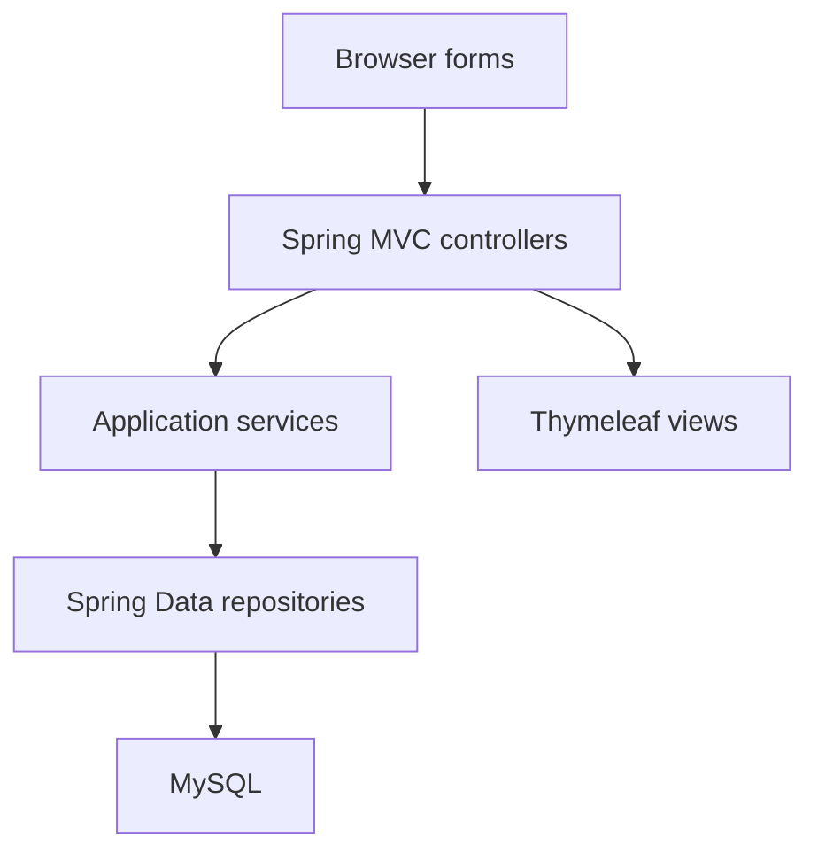

# Technical review — Java Library

Historical source baseline: `673bad6a2789e462ef258bca3fe261cde53064fd`.
Security-change starting point: `7f2e56987050b2e721efba394c99ef796da975c0`.
This is a review and bounded maintenance case study, not a security certification.

## Implemented architecture

Some controllers still access repositories directly; the layering is not an enforced module boundary.

## Security maintenance implemented

The original review identified disabled CSRF, incomplete endpoint authorization and destructive GET handlers. The current [security configuration](../src/main/java/com/egg/libreria2/Security.java) explicitly permits read-only catalog routes, reserves catalog management for ADMIN, denies unlisted requests and retains default CSRF protection. All three deletion handlers now use POST and their templates render CSRF-bearing forms. Login, registration and logout forms are covered by the HTTP tests.

See the [security case study](SECURITY_HARDENING.md) for the policy, 71-test local result and remaining limits. These corrections do not close unrelated service, persistence, dependency or deployment concerns.

## Open observations

| Observation | Evidence | Proposed change — not implemented here |
| --- | --- | --- |
| Quantity fields lack a full stock invariant | [LibroService](../src/main/java/com/egg/libreria2/services/LibroService.java), `AgregarLibro`/`Save` | Reject negative values and inconsistent totals in the service |
| Missing records use `Optional.get()` before the presence check | Same service, `eliminarLibro` | Resolve once with an explicit not-found outcome |
| Schema auto-update | [application.yml](../src/main/resources/application.yml) | Baseline and version migrations against a disposable DB |
| HTTP-only authorization boundary | [Security.java](../src/main/java/com/egg/libreria2/Security.java) | Review service entry points before introducing non-HTTP callers |
| Historical dependency/configuration state | [pom.xml](../pom.xml) and repository history | Separate upgrade, advisory and secret/artifact audit |

Real MySQL persistence, domain-invariant, rollback and concurrency tests remain proposed. No Docker Compose, Flyway migration, OpenAPI specification or production deployment was added by this maintenance.

## Interview discussion

Present this as an earlier learning application followed by a measured security improvement. Establish personal contributions from commits and retain team attribution.

1. Why does login alone not protect a destructive operation?
2. Why do authorization and CSRF need separate negative tests?
3. How does an HTTP filter boundary differ from service-level authorization?
4. What do rendered-form round trips prove that an injected test CSRF token does not?
5. Why do 71 passing MVC tests leave database invariants and dependency risk open?
